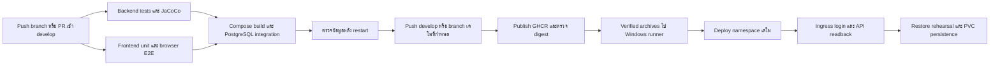

# งาน GitHub / CI/CD / Docker / Kubernetes ที่ทีมต้องรู้

จัดทำวันที่ 13 ตุลาคม 2026 สำหรับ Present วันที่ 17 ตุลาคม 2026

## ขอบเขตที่รับผิดชอบ

งานของ Natthapumin คือทำให้ source ที่ทีมส่งเข้า `develop` ถูกทดสอบ สร้างเป็น image และนำไปเปิดบน Kubernetes ได้ พร้อมเก็บหลักฐานว่าใช้ commit และ image ใด งานนี้เพิ่มรายงาน backend coverage และทดสอบการเชื่อม API กับ PostgreSQL รวมถึง browser flow บางส่วน

ฟังก์ชันทางธุรกิจและการเปลี่ยน DB ยังต้องใช้ผลของเจ้าของ module การที่ pipeline ผ่านไม่ได้ยืนยันว่าทุก feedback หรือทุกสูตร commission ถูก implement แล้ว

## ทีมต้องรู้เกี่ยวกับ branch และ DB

| รายการ | สถานะที่ตรวจได้วันที่ 13 ต.ค. |
|---|---|
| Repository ที่ใช้ส่ง | `MUDST-2026-Sabyeguyz/Sabyeguyz-Clinic_ERP` |
| ฐานที่ใช้ทำงานนี้ | `develop` SHA `c62d68b07aae805d9b79492bbd6be8c5eee1cdab` |
| งาน DevOps รอบนี้ | `codex/presentation-devops-20261017` เตรียม PR เข้า `develop` |
| DB ล่าสุดที่ทีมแจ้ง | `feat/database` SHA `ab4e0d29158560b10857e0a8be5c4bde43c7fcad`, PR #23 ยังเปิดอยู่ |
| DB ที่ API บน develop ใช้ | Flyway `db/migration` เดิมร่วมกับ `db/vendor/{vendor}` |
| DB ล่าสุดใน feat/database | ย้าย schema ใหม่เข้า `db/migration`, เปลี่ยน runtime/API/CI หลายส่วน; เป็นงาน integration แยก |
| Kubernetes demo | Context `clinic-phase1`, namespace `clinic-erp-demo-20261017`, path `/sabyeguyz/` |

การสร้าง schema ผ่านใน PostgreSQL เป็นหลักฐานของ DB ระดับหนึ่ง การนำมาใช้ส่งจริงต้องรวม PR #23 และตรวจ API/tests/CI อีกครั้งบน commit หลังรวม ห้ามนำ V1 ใหม่ไปแทน V1 ของฐานข้อมูลเดิมที่มีประวัติ Flyway แล้ว ให้เจ้าของ DB ระบุว่าจะใช้ DB ใหม่หรือรักษาข้อมูลเดิมอย่างไร

เดโมรอบนี้สร้าง PostgreSQL ใหม่ใน namespace แยก ใช้ข้อมูลสังเคราะห์ ไม่ใช้ PVC ของ `clinic-erp-phase1`

## Pipeline ทำอะไรบ้าง

| ไฟล์ | หน้าที่ |
|---|---|
| `.github/workflows/compose-verify.yml` | Workflow หลัก `Clinic CI/CD`; เรียก tests แล้วทำ integration/publish/deploy |
| `.github/workflows/backend-ci.yml` | Reusable workflow: Maven verify + upload Surefire XML และ JaCoCo HTML/XML/CSV |
| `.github/workflows/frontend-ci.yml` | Reusable workflow: npm ci, unit, production build, Cypress กับ backend/PostgreSQL จริง |
| `backend/pom.xml` | เพิ่ม JaCoCo โดยรักษา JVM argument ที่ Mockito ต้องใช้ |
| `scripts/ci/api-smoke.py` | ตรวจ unauthenticated 401, Manager login, patient create/read/search และ readback หลัง restart |
| `frontend/cypress/e2e/patient-readback.cy.js` | Login ผ่าน UI, สร้าง patient ผ่าน API จริง แล้วเปิด profile และ reload |
| `frontend/Dockerfile`, `frontend/vite.config.ts`, `frontend/src/api/client.ts` | รองรับ build prefix `/sabyeguyz/` และส่งกลับ login ที่ prefix เดิมเมื่อ token หมดอายุ; local build ปกติยังใช้ `/` |
| `deploy/k8s/clinic-demo.template.yaml` | ConfigMap, Services, Deployments, PostgreSQL StatefulSet/PVC, Traefik Middleware และ Ingress |
| `scripts/ci/image-provenance.py` | ตรวจ archive config กับ registry descriptor และเก็บ archive SHA256/source identity |
| `scripts/deploy/deploy-demo.ps1` | ตรวจ archive checksum/config, render/dry-run/import/deploy/Ingress/restore/persistence และ image rollback เมื่อ schema ยังตรงเดิม |
| `scripts/deploy/send-image.py` | ส่ง archive แบบ binary เข้า `/var/lib` ของ node ผ่าน exec แล้วตรวจ hash บน node; เลี่ยง filesystem view ของ Docker copy ใน `/tmp` |
| `scripts/deploy/open-demo.ps1` | เปิด Traefik ที่ localhost:16969 สำหรับพรีเซนต์ |

## GitHub runner คืออะไร และเราใช้แบบไหน

Runner คือเครื่องที่รับ jobs จาก GitHub Actions แล้วรันคำสั่งตาม workflow

| Runner | ใช้ทำงานอะไร | สิ่งที่ต้องพร้อม |
|---|---|---|
| GitHub-hosted `ubuntu-latest` | Maven, npm, Cypress, Docker build, PostgreSQL integration, publish GHCR | GitHub Actions และสิทธิ์ packages ของ job |
| Self-hosted Windows `clinic-phase1-windows-x64` | ดาวน์โหลด archive ของ run เดียวกัน ตรวจ hash/config แล้ว import เข้า Minikube, kubectl deploy และตรวจ Ingress | เครื่องนี้เปิด, Docker พร้อม, Minikube พร้อม, runner online |

Labels ของ Windows runner คือ `self-hosted`, `Windows`, `X64`, `clinic-phase1`, `powershell7` โดย repo variable `CLINIC_MINIKUBE_EXE` ระบุ executable ในเครื่องนี้

PR รันการทดสอบบน GitHub-hosted runner ส่วน deploy ใช้เฉพาะ push/dispatch ของ `develop` และ branch เดโม `codex/presentation-devops-20261017` ที่กำหนดไว้ เงื่อนไขนี้ช่วยให้ PR ที่ยังไม่รวมไม่แก้ cluster โดยอัตโนมัติ หลังรวมงานและจบพรีเซนต์สามารถเอา branch เดโมออกจากเงื่อนไข publish/deploy ได้

## สิ่งที่ frontend ต้องทำ

1. ส่ง source และ `package-lock.json` พร้อมกัน ใช้ `npm ci` ให้ทำซ้ำได้
2. ตรวจ `npm run test:unit -- --run` และ `npm run build` ก่อนเปิด PR
3. UI ต้องเรียก API ด้วย base URL ที่กำหนด และ router ต้องใช้ `import.meta.env.BASE_URL` เพื่อเปิดใต้ `/sabyeguyz/`
4. เพิ่ม E2E ตาม module ของตัวเอง; tests รอบนี้ครอบคลุม login และ patient readback บางส่วน ยังไม่ครอบคลุมทุกหน้า
5. อย่าใช้ข้อมูลผู้ป่วยจริงในการทดสอบหรือ screenshots ที่เก็บเป็น artifact

## สิ่งที่ backend / DB ต้องทำ

1. ระบุ commit/schema ที่ใช้ร่วมกันก่อนรวมเข้า `develop` ให้ชัด โดยเฉพาะ PR #23
2. รัน unit/integration ของ module ตัวเอง; JaCoCo จะแสดงทั้งส่วนที่มีและไม่มีการทดสอบ ไม่ตั้งเปอร์เซ็นต์สมมติ
3. แยกการทดสอบ H2 ใน Maven จาก PostgreSQL integration จริงใน pipeline
4. เตรียมบัญชี Manager สังเคราะห์ตาม fixture ของ schema ถ้าเปลี่ยน bootstrap ให้ปรับ smoke/E2E ด้วย; บัญชีตัวอย่างปัจจุบันเป็น dev fixture และไม่เหมาะกับข้อมูลจริง
5. หลัง schema ใหม่รวม ต้องปรับ patient smoke ตาม API contract ใหม่และทดสอบใน DB/PVC ใหม่ที่ระบุ ห้ามใช้ image rollback เป็นการย้อน schema
6. ใส่กรณีทดสอบ commission ตามเอกสารค่าตอบแทนล่าสุดใน `FEEDBACK_AND_ACCEPTANCE_TH.md`

## หลักฐานที่ใช้พรีเซนต์

ทุกหลักฐานต้องบอก source SHA และ environment สำหรับ GitHub ให้เปิด run ที่ SHA ตรงกับ code ที่เดโม แล้วดาวน์โหลด artifact:

- `backend-tests-and-jacoco-<SHA>`: จำนวน tests และ coverage ที่วัดจริง
- `compose-evidence-<SHA>`: authenticated API, direct PostgreSQL readback, restart persistence และ image digests
- `clinic-images-<SHA>`: image archives + registry descriptors + config identity + SHA256; เก็บ 7 วันสำหรับ deploy/demo
- `kubernetes-demo-<SHA>`: image refs ที่ deploy, Ingress, PVC UID, Flyway history, restore และ readback หลัง recreate
- ใน Kubernetes artifact มี `DEPLOYMENT_REPORT_TH.md` ซึ่งสร้างผลภาษาไทยหลังตรวจผ่านทั้งหมด ใช้ส่งต่อผลของ run ให้เพื่อนได้

Coverage backend ใช้สูตร `covered / (covered + missed) * 100` จาก JaCoCo แยก line, branch, instruction และ method ส่วน E2E ให้รายงานจำนวน scenario/module ที่มีหลักฐาน อย่าพูดว่า “E2E 100%” จากการมี specs ผ่านเพียงบางหน้า

Restore rehearsal ของเดโมใช้ DB สังเคราะห์แยก และทิ้ง dump หลังตรวจ ไม่ใช่นโยบาย backup รายวันหรือ off-cluster backup สำหรับ production

Local Docker 29/containerd พบปัญหา export image หลัง pull (manifest อ้างถึง blob ที่ไม่มีใน tar) จึงให้ Linux CI export หลัง build/publish/pull แล้ว Windows download artifact ของ run เดียวกันและ import เข้า containerd โดยตรง โดยตรวจ archive SHA256 และ config digest ก่อน deploy ไม่ต้องเพิ่ม PAT บน Windows และไม่สลับ Docker image-store mode ของเครื่อง

อ้างอิงอาการที่เกี่ยวข้องจากผู้พัฒนา: [Moby #52193](https://github.com/moby/moby/issues/52193), [Docker CLI #7278](https://github.com/docker/cli/issues/7278) ส่วนหลักฐานว่าเกิดกับเครื่องนี้มาจาก deployment log และ tar ที่ export ในการตรวจรอบนี้

## สิ่งที่ต้องทำก่อนส่ง develop

- Review PR ของ DevOps และ DB แยกกัน แล้วตกลงลำดับรวม
- ถ้ารวม DB ก่อน ให้ rebase งานนี้และตรวจ reusable workflows/smoke/fixtures บน runtime ใหม่
- ตรวจ required checks ใน repository settings ให้ตรงกับชื่อ jobs ใหม่ก่อน merge; งานนี้ไม่ได้เปลี่ยน branch protection
- การอ่าน branch protection ด้วย API รอบนี้ตอบ 403 จึงไม่ได้ยืนยันว่ามี required checks บังคับอัตโนมัติ ให้ทีม review ผล CI ของ PR ก่อนรวม
- ใช้ CI ที่ SHA หลังรวม และ demo namespace ที่ผูกกับ image digest ของ SHA นั้น
- Financial acceptance, permission matrix และ feedback business flows ต้องมีหลักฐานเพิ่มจากทีม

อ้างอิง: [GitHub self-hosted runners](https://docs.github.com/en/actions/reference/runners/self-hosted-runners), [Kubernetes StatefulSet](https://kubernetes.io/docs/concepts/workloads/controllers/statefulset/), [Ingress](https://kubernetes.io/docs/concepts/services-networking/ingress/)
