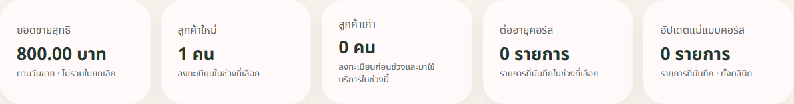
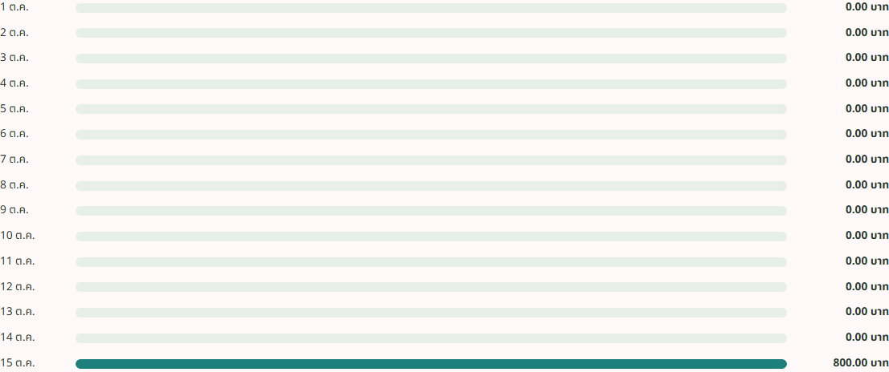

# P8 Dashboard Q11 — approved definitions and implementation

15 October 2026, `feat/p8-p9-reports-release`. Feature commit tested: **0de5e2af9be97f6f05293b218b037f062679859d**, based on `8cf70fa`.

## Approved by the user

- New customers: registered within the selected Bangkok date range, even without attendance.
- Returning customers: registered before the range and attended within it, counted once per patient.
- Renewals and package updates: event counts, not action buttons.
- Package updates mean Back Office course-template edits, not changes to a patient's purchased package.

## Delivered

- Additive dashboard API fields: newCustomers, returningCustomers, courseRenewals, packageUpdates, packageUpdatesScope, salesTotal, cashReceived, dailySales. Existing fields remain.
- New customers use registration branch; returning customers use visit branch. Bangkok ranges are start-inclusive/end-exclusive. Two visits by one older patient still count as one returning customer.
- Net sales use non-Voided receipt net amounts by sale date. Cash uses successful payment dates, before refunds. Daily sales include zero days; the existing category chart remains cash-based and is labelled accordingly.
- Course renewals count persisted course_extension rows by event date/course branch. P7's extension API and expiry policy are still separate work; no new lifecycle rule was introduced.
- Template edits write old/new/actor/time audit records in the same transaction. Count real successful changes; ignore no-op saves, creations and deletions. Templates are shared, so the UI explicitly labels updates as clinic-wide.
- Historical template edits were not logged by this mechanism; no count was invented from updatedAt. The UI says recorded events.
- Remove the dashboard's fallback from zero attended patients to the entire patient directory. A registration without attendance now shows new=1, attended=0.
- Display money to two decimals. Use stable chart tick keys to avoid duplicate Vue keys for an empty chart.
- No schema migrations, commission calculations or P6/P7 lifecycle rules changed.

## Verification

| Check | Result |
|---|---|
| New API RED before implementation | 9/9 fail because fields/range handling are absent |
| New API scoped GREEN | 9/9 pass |
| Full v2 HTTP suite | **226/226**, 25 specs; includes commission **17/17** |
| Frontend unit | **51/51** |
| Full browser suite | **120/120**, 14 specs, dashboard **8/8** |
| Final dashboard browser after screenshot/tick-key adjustments | **8/8** |
| Frontend type-check/build and scoped ESLint | pass |
| Backend Maven package | pass |
| Production RuntimeCheck | RUNTIME_CHECK_OK on a fresh disposable DB |
| SchemaCheck | 494 mapped columns / 0 problems; 45 entities, 22 controllers, 32 services; SCHEMA_CHECK_OK |
| Production jar inspection | contains DashboardMetricsService; excludes CypressDashboardFixturesController |
| git diff --check | pass |

Commands: backend `npx cypress run --config-file cypress.v2.config.cjs` against the dedicated v2 test server; frontend `npx cypress run --config-file cypress.v2.config.ts`; `npm run test:unit -- --run`; `npm run build`; backend `mvn --batch-mode --no-transfer-progress package`. Runtime/schema use DB_URL/DB_USER/DB_PASSWORD with test classpath as in the existing acceptance guide.

All runtime tests use PostgreSQL16.15 in `clinic-p8p9-20261015`, port55439, test DB `clinic_p8p9`; runtime checks use fresh `p8_q11_runtime_20261015`. No production database was used.

## Investigation / qualifications

- The first browser RED found the new cards missing. It also saw JSON sale requests fail415. A direct JSON HTTP request reproduced415; compiled main-class files were then found missing. Rebuilding restored the files and the same sale request returned201, followed by full API226 and browser120 passing. No sale API logic was changed to hide the error; the cause of the missing build outputs was not established.
- SchemaCheck's manual context initially lacked ObjectMapper after the template controller began using Boot's mapper. Added the matching mapper bean to the test-only wiring context, then verified SCHEMA_CHECK_OK.
- Global CSS smooth scrolling cropped/stitched initial Cypress screenshots incorrectly. Disabled smooth scrolling only during capture in this test and inspected the final card/chart images. Application scroll behavior is unchanged.
- Existing Electron/screenshots-cleanup/Vite warnings remain. A PatientSearch mounted-hook warning occurred in the browser run outside the changed dashboard; no claim that all console warnings were resolved.
- Full suites ran before the final chart-key/screenshot-only changes; the affected dashboard suite and build/lint were rerun after those changes. Only a Java comment changed after the full API run; final package passed.
- Self-review completed. Hosted Actions and independent review were not run, and no merge/deploy is claimed.

## Visual evidence

Synthetic test case: one registration, no visits, an unpaid800-baht sale; recorded renewals/template edits are0 in this screenshot.

## Remaining release work

Q11's definitions are implemented. Q12 Calendar/rooms/reset, Q9 report permission policy and final P9/P6/P7/accounting gates remain. As checked near07:53, parent remote is844e83a and friend's P6/P7 remote isedfc4e6 (A1 only). Do not merge the entire release or claim P8/P9 complete from this scoped delivery. No push/merge/deploy was performed.
